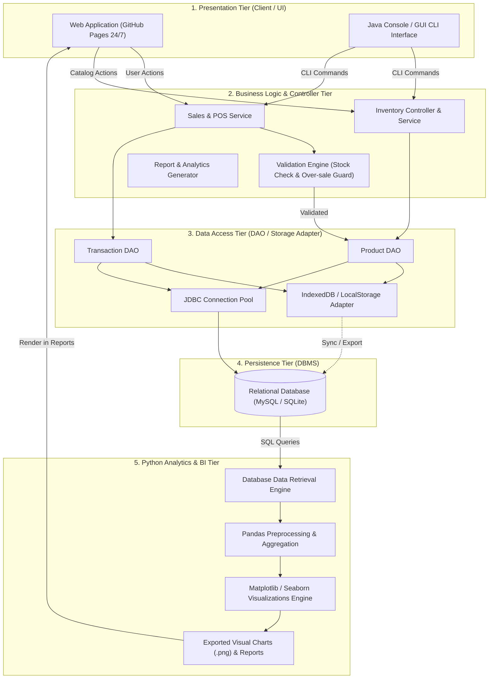
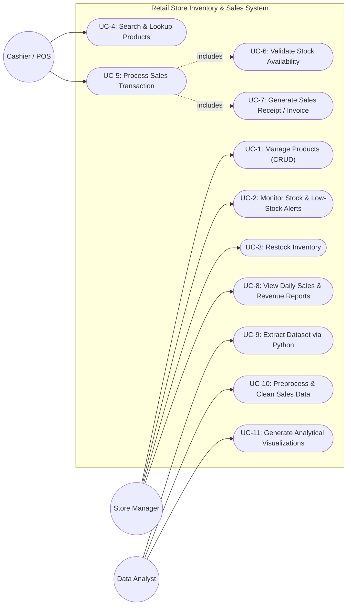
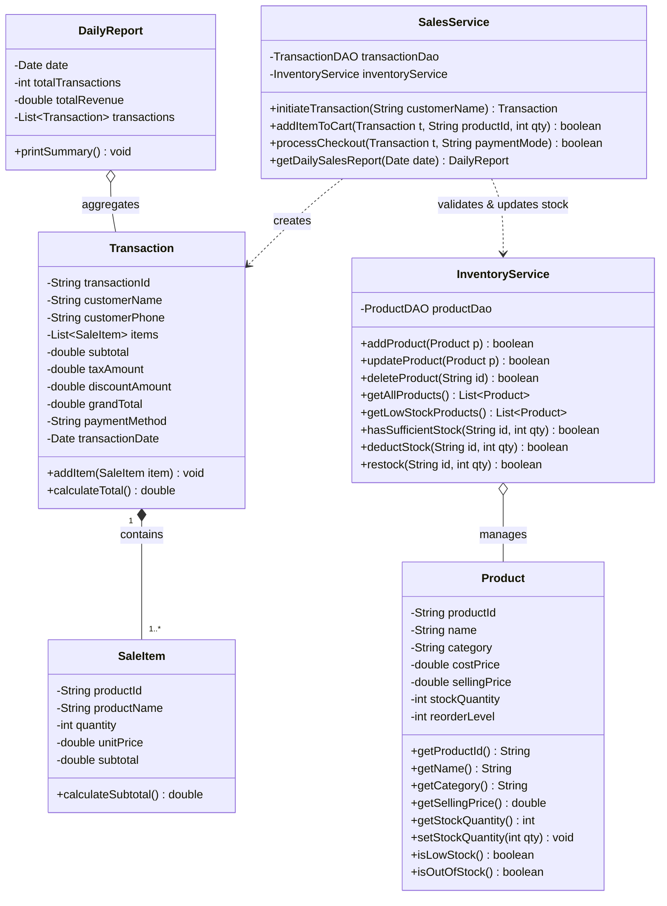
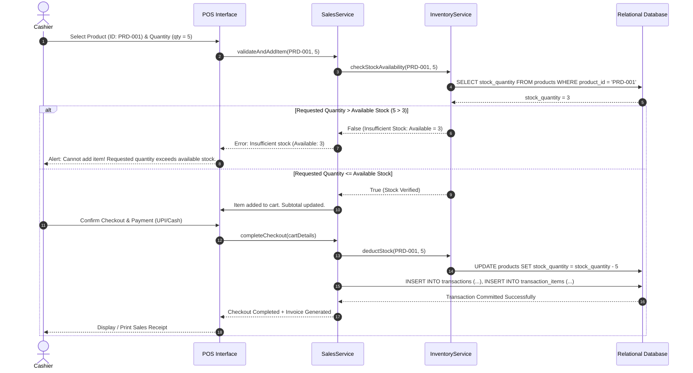
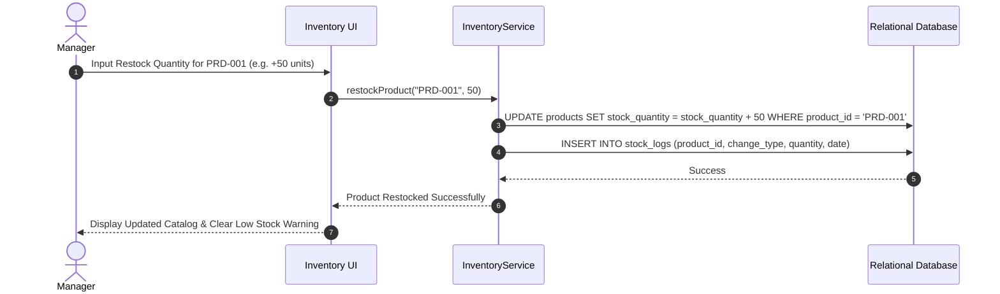

# System Design and Architecture Diagrams

## For Retail Store Inventory and Sales Analysis System

---

### **Velalar College of Engineering and Technology (Autonomous)**
**Department of Information Technology**  
**Academic Year:** 2026 - 2027 (ODD) | **Class:** 25IT3A  
**Scenario 9:** Retail Store Inventory and Sales Analysis System  
**Author:** Ashvika K (Reg No: 732925ITR009)  

---

## 1. Overall System Architecture

The Retail Store Inventory and Sales Analysis System follows a **Multi-Tier Layered Architecture** separating the user interface, business logic, data persistence, and data intelligence analytics:

---

## 2. Use Case Diagram

### 2.1 Actors
1. **Store Manager / Inventory Administrator:** Manages catalog, restocks products, sets reorder thresholds, and monitors sales/inventory reports.
2. **Cashier / POS Operator:** Looks up items, creates carts, processes payments, and prints invoices.
3. **Data Analyst / Auditor:** Extracts dataset from database, runs Python preprocessing pipelines, and evaluates business patterns.

### 2.2 Diagram

---

## 3. Class Diagram

The object-oriented design leverages the **Data Access Object (DAO)** and **Service-Controller** design patterns for high cohesion and loose coupling:

---

## 4. Sequence Diagrams

### 4.1 Processing a Sale with Stock Availability Validation
This diagram highlights **Functional Requirement 4** (preventing sales exceeding available stock) and **Functional Requirement 3** (automatic stock deduction):

### 4.2 Product Restock Sequence

