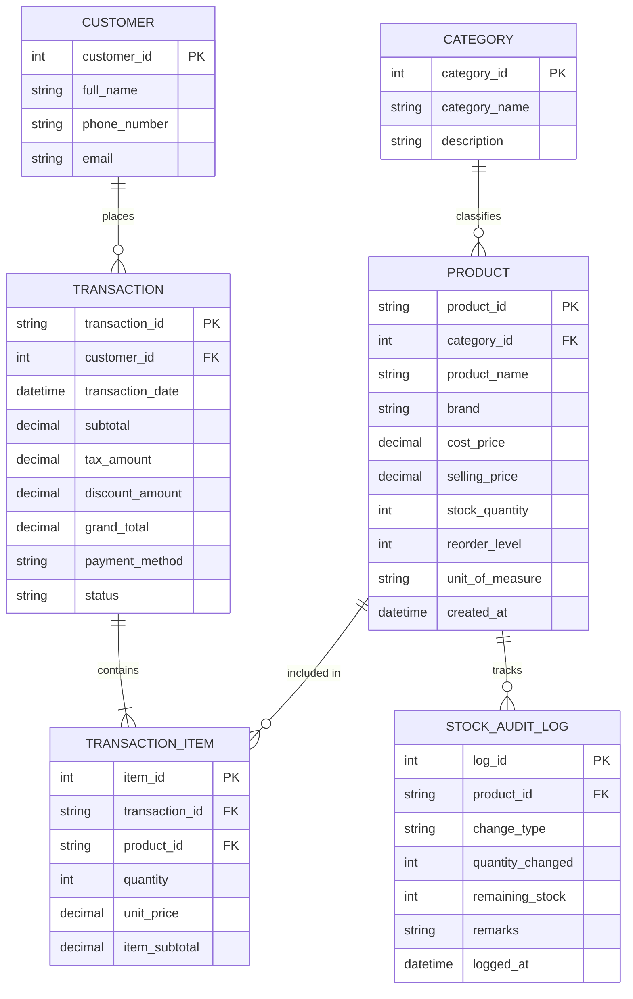

# Entity-Relationship (ER) Diagram & Database Normalization Document

## For Retail Store Inventory and Sales Analysis System

---

### **Velalar College of Engineering and Technology (Autonomous)**
**Department of Information Technology**  
**Academic Year:** 2026 - 2027 (ODD) | **Class:** 25IT3A  
**Scenario 9:** Retail Store Inventory and Sales Analysis System  
**Author:** Ashvika K (Reg No: 732925ITR009)  

---

## 1. Entity-Relationship (ER) Model

The Retail Store database maintains entities for products, categories, sales transactions, line items, and audit logs to record product movements and sales accurately.

### 1.1 ER Diagram


### 1.2 Entity Descriptions & Cardinalities
1. **CATEGORY (1) to PRODUCT (M):** One category classifies zero or more products. Each product belongs to exactly one category.
2. **PRODUCT (1) to TRANSACTION_ITEM (M):** A product may appear in multiple sales transaction items. Each transaction item references exactly one product.
3. **TRANSACTION (1) to TRANSACTION_ITEM (M):** A sales transaction contains one or more line items. Each line item belongs strictly to one parent transaction (Composition relationship).
4. **CUSTOMER (1) to TRANSACTION (M):** A registered customer may execute multiple purchases over time.
5. **PRODUCT (1) to STOCK_AUDIT_LOG (M):** Every inventory change (sale, restock, manual adjustment) generates an immutable log entry.

---

## 2. Relational Model Schema

```sql
CATEGORIES (
    category_id (PK),
    category_name,
    description
)

PRODUCTS (
    product_id (PK),
    category_id (FK -> CATEGORIES.category_id),
    product_name,
    brand,
    cost_price,
    selling_price,
    stock_quantity,
    reorder_level,
    unit_of_measure,
    created_at
)

CUSTOMERS (
    customer_id (PK),
    full_name,
    phone_number,
    email
)

TRANSACTIONS (
    transaction_id (PK),
    customer_id (FK -> CUSTOMERS.customer_id),
    transaction_date,
    subtotal,
    tax_amount,
    discount_amount,
    grand_total,
    payment_method,
    status
)

TRANSACTION_ITEMS (
    item_id (PK),
    transaction_id (FK -> TRANSACTIONS.transaction_id),
    product_id (FK -> PRODUCTS.product_id),
    quantity,
    unit_price,
    item_subtotal
)

STOCK_AUDIT_LOGS (
    log_id (PK),
    product_id (FK -> PRODUCTS.product_id),
    change_type,
    quantity_changed,
    remaining_stock,
    remarks,
    logged_at
)
```

---

## 3. Database Normalization Analysis

To guarantee database integrity, prevent update, deletion, and insertion anomalies, and eliminate data redundancy, the relational schema is subjected to rigorous normalization from **UNF to 3NF and BCNF**.

### 3.1 Unnormalized Form (UNF)
In a manual paper record or spreadsheet invoice, a single transaction record contains multi-valued attributes and repeating groups:

$$\text{RETAIL\_INVOICE(TxnID, Date, CustName, CustPhone, \{ProdID, ProdName, Category, Price, Qty, Subtotal\}, GrandTotal, PaymentMode)}$$

- **Problem:** Repeating groups of `{ProdID, ProdName, Category, Price, Qty, Subtotal}` inside a single record violate relational database integrity.

---

### 3.2 First Normal Form (1NF)
**Definition:** A relation is in 1NF if and only if all underlying domains contain only atomic (indivisible) values, and there are no repeating groups or arrays.

- **Action:** Flatten the repeating groups by creating a composite primary key consisting of `(transaction_id, product_id)`.
- **Intermediate 1NF Relation:**
$$\text{SALES\_FLAT}(\underline{\text{transaction\_id}}, \underline{\text{product\_id}}, \text{date}, \text{cust\_name}, \text{cust\_phone}, \text{prod\_name}, \text{category}, \text{price}, \text{qty}, \text{item\_total}, \text{grand\_total}, \text{payment\_mode})$$

- **Anomalies remaining in 1NF:**
  - *Insertion Anomaly:* Cannot add a new product into the system until a sale occurs (since `transaction_id` is part of the primary key).
  - *Deletion Anomaly:* Deleting the last transaction containing a product deletes the product information entirely.
  - *Update Anomaly:* If a product price changes, it must be updated across hundreds of past transaction records.

---

### 3.3 Second Normal Form (2NF)
**Definition:** A relation is in 2NF if it is in 1NF and every non-prime attribute is fully functionally dependent on the entire primary key (no partial functional dependencies).

- **Analysis of Functional Dependencies in 1NF relation:**
  - Composite Key: `(transaction_id, product_id)`
  - $FD_1: \{\text{transaction\_id}, \text{product\_id}\} \rightarrow \{\text{qty}, \text{item\_total}\}$ *(Fully dependent)*
  - $FD_2: \{\text{transaction\_id}\} \rightarrow \{\text{date}, \text{cust\_name}, \text{cust\_phone}, \text{grand\_total}, \text{payment\_mode}\}$ *(Partial dependency on transaction_id)*
  - $FD_3: \{\text{product\_id}\} \rightarrow \{\text{prod\_name}, \text{category}, \text{price}\}$ *(Partial dependency on product_id)*

- **Decomposition into 2NF:**
  1. $\text{PRODUCTS}(\underline{\text{product\_id}}, \text{prod\_name}, \text{category}, \text{cost\_price}, \text{selling\_price}, \text{stock\_quantity}, \text{reorder\_level})$
  2. $\text{TRANSACTIONS}(\underline{\text{transaction\_id}}, \text{customer\_id}, \text{date}, \text{subtotal}, \text{tax}, \text{grand\_total}, \text{payment\_mode})$
  3. $\text{TRANSACTION\_ITEMS}(\underline{\text{item\_id}}, \text{transaction\_id}^*, \text{product\_id}^*, \text{quantity}, \text{unit\_price}, \text{item\_subtotal})$

- **Outcome:** All partial dependencies are eliminated.

---

### 3.4 Third Normal Form (3NF)
**Definition:** A relation is in 3NF if it is in 2NF and no non-prime attribute is transitively dependent on the primary key (no $X \rightarrow Y$ and $Y \rightarrow Z$ where $Z$ is non-prime).

- **Analysis of Transitive Dependencies:**
  - In `PRODUCTS`, if category description or category metadata depends on `category_name`:
    $$\text{product\_id} \rightarrow \text{category\_name} \rightarrow \text{category\_description}$$
  - In `TRANSACTIONS`, customer contact information depends on `customer_id`:
    $$\text{transaction\_id} \rightarrow \text{customer\_id} \rightarrow \{\text{full\_name}, \text{phone\_number}, \text{email}\}$$

- **Decomposition into 3NF:**
  1. Extract $\text{CATEGORIES}(\underline{\text{category\_id}}, \text{category\_name}, \text{description})$
  2. Extract $\text{CUSTOMERS}(\underline{\text{customer\_id}}, \text{full\_name}, \text{phone\_number}, \text{email})$
  3. Relate $\text{PRODUCTS}$ to $\text{CATEGORIES}$ via `category_id` (Foreign Key).
  4. Relate $\text{TRANSACTIONS}$ to $\text{CUSTOMERS}$ via `customer_id` (Foreign Key).

- **Outcome:** Every non-prime attribute depends solely on the candidate key: **"The key, the whole key, and nothing but the key"**. The schema is in **3NF**.

---

### 3.5 Boyce-Codd Normal Form (BCNF) Verification
**Definition:** A relation is in BCNF if for every non-trivial functional dependency $X \rightarrow Y$, $X$ is a superkey.
- In all decomposed tables (`CATEGORIES`, `PRODUCTS`, `CUSTOMERS`, `TRANSACTIONS`, `TRANSACTION_ITEMS`, `STOCK_AUDIT_LOGS`), the determinant $X$ of every functional dependency is a candidate key or primary key.
- Therefore, the schema is strictly in **Boyce-Codd Normal Form (BCNF)**.

---

## 4. Comprehensive Data Dictionary

### Table 1: `categories`
| Column Name | Data Type | Constraints | Description |
|---|---|---|---|
| `category_id` | INT | PRIMARY KEY, AUTO_INCREMENT | Unique identifier for product category |
| `category_name` | VARCHAR(50) | NOT NULL, UNIQUE | Name of the category (e.g., Grocery, Dairy) |
| `description` | VARCHAR(255) | NULL | Brief description of the category |

### Table 2: `products`
| Column Name | Data Type | Constraints | Description |
|---|---|---|---|
| `product_id` | VARCHAR(20) | PRIMARY KEY | Unique alphanumeric SKU (e.g., PRD-001) |
| `category_id` | INT | NOT NULL, FOREIGN KEY | References `categories(category_id)` |
| `product_name` | VARCHAR(100) | NOT NULL | Commercial product name |
| `brand` | VARCHAR(50) | NULL | Manufacturer or brand name |
| `cost_price` | DECIMAL(10,2) | NOT NULL, CHECK (cost_price >= 0) | Acquisition cost per unit |
| `selling_price` | DECIMAL(10,2) | NOT NULL, CHECK (selling_price >= cost_price) | Retail sales price per unit |
| `stock_quantity` | INT | NOT NULL, DEFAULT 0, CHECK (stock_quantity >= 0) | Current physically available units |
| `reorder_level` | INT | NOT NULL, DEFAULT 5, CHECK (reorder_level >= 0) | Threshold triggering low-stock alert |
| `unit_of_measure` | VARCHAR(20) | DEFAULT 'pcs' | Units (pcs, kg, litre, pack) |
| `created_at` | TIMESTAMP | DEFAULT CURRENT_TIMESTAMP | Timestamp when product was added |

### Table 3: `customers`
| Column Name | Data Type | Constraints | Description |
|---|---|---|---|
| `customer_id` | INT | PRIMARY KEY, AUTO_INCREMENT | Customer system ID |
| `full_name` | VARCHAR(100) | NOT NULL | Customer name |
| `phone_number` | VARCHAR(15) | NULL | Contact mobile number |
| `email` | VARCHAR(100) | NULL | Email address |

### Table 4: `transactions`
| Column Name | Data Type | Constraints | Description |
|---|---|---|---|
| `transaction_id` | VARCHAR(30) | PRIMARY KEY | Unique invoice ID (e.g., TXN-20261119-001) |
| `customer_id` | INT | NULL, FOREIGN KEY | References `customers(customer_id)` |
| `transaction_date` | TIMESTAMP | NOT NULL, DEFAULT CURRENT_TIMESTAMP | Date and time when sale was completed |
| `subtotal` | DECIMAL(10,2) | NOT NULL, CHECK (subtotal >= 0) | Net total before tax and discounts |
| `tax_amount` | DECIMAL(10,2) | NOT NULL, DEFAULT 0.00 | Applicable sales tax (GST 5% / 12% / 18%) |
| `discount_amount`| DECIMAL(10,2) | NOT NULL, DEFAULT 0.00 | Applied promotional discount |
| `grand_total` | DECIMAL(10,2) | NOT NULL, CHECK (grand_total >= 0) | Final payable amount |
| `payment_method` | VARCHAR(20) | NOT NULL | Cash, Card, UPI, NetBanking |
| `status` | VARCHAR(20) | DEFAULT 'COMPLETED' | Status: COMPLETED, CANCELLED, REFUNDED |

### Table 5: `transaction_items`
| Column Name | Data Type | Constraints | Description |
|---|---|---|---|
| `item_id` | INT | PRIMARY KEY, AUTO_INCREMENT | Unique line item record ID |
| `transaction_id` | VARCHAR(30) | NOT NULL, FOREIGN KEY | References `transactions(transaction_id)` |
| `product_id` | VARCHAR(20) | NOT NULL, FOREIGN KEY | References `products(product_id)` |
| `quantity` | INT | NOT NULL, CHECK (quantity > 0) | Units purchased in this line item |
| `unit_price` | DECIMAL(10,2) | NOT NULL, CHECK (unit_price >= 0) | Unit price at time of sale |
| `item_subtotal` | DECIMAL(10,2) | NOT NULL | `quantity * unit_price` |

### Table 6: `stock_audit_logs`
| Column Name | Data Type | Constraints | Description |
|---|---|---|---|
| `log_id` | INT | PRIMARY KEY, AUTO_INCREMENT | Audit sequence ID |
| `product_id` | VARCHAR(20) | NOT NULL, FOREIGN KEY | References `products(product_id)` |
| `change_type` | VARCHAR(20) | NOT NULL | SALE, RESTOCK, ADJUSTMENT, RETURN |
| `quantity_changed`| INT | NOT NULL | Signed integer (+ for restock, - for sale) |
| `remaining_stock`| INT | NOT NULL, CHECK (remaining_stock >= 0) | Balance remaining after change |
| `remarks` | VARCHAR(255) | NULL | Transaction or PO reference |
| `logged_at` | TIMESTAMP | DEFAULT CURRENT_TIMESTAMP | Audit log timestamp |
